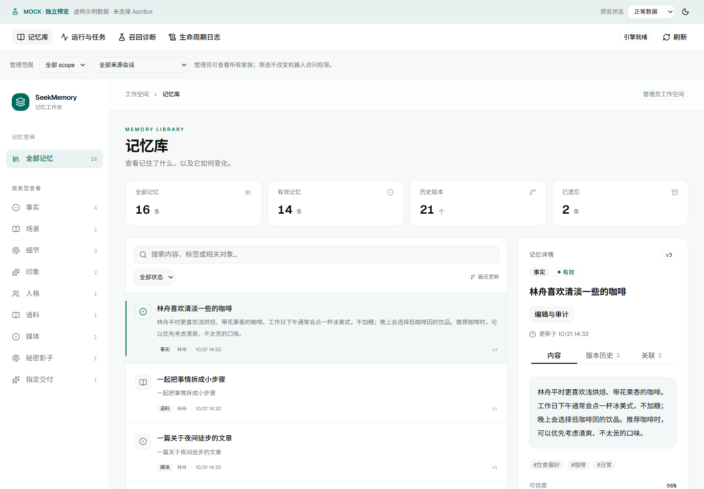
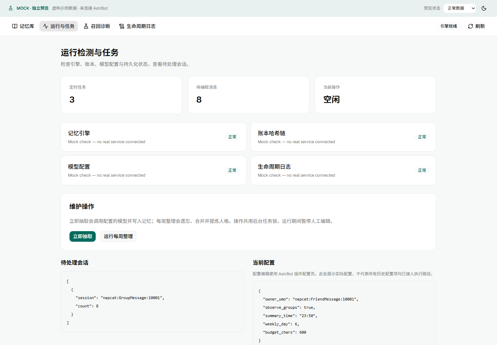
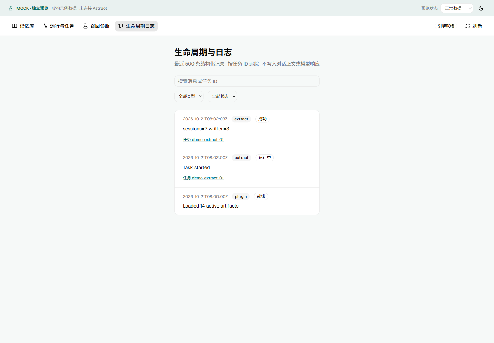

# SeekMemory plugin view

Install the Release attachment `astrbot_plugin_seekmemory.zip`, reload the plugin,
then open its view from the AstrBot plugin card. A host supporting plugin views
and `astrbot.api.web` is required; host APIs were validated with AstrBot 4.28.1.
Navigation mapping: **Plugin configuration** remains the configuration editor;
the new **Plugin view** contains memory management. AstrBot navigation is unchanged.

The workspace provides all six artifact families, scope/session/state filters,
version comparison, related records, raw evidence, blob hashes and ledger entries.
Edit JSON, scope or active/forgotten state with an audit reason and confirmation.
Every save appends a revision and ledger entry atomically; stale revisions conflict.
Loading an older payload creates an editable draft, not an immediate rollback.
Merged records cannot be independently restored. Editing does not rebuild graph edges.

Administrators can inspect every scope. `private` uses conversation ownership;
`shared` is visible across conversations; `shadow` enters the same candidate pool
but assembly hides its content. The source-session filter does not change access.
Read-only recall diagnostics accept a UMO, sender ID and query, reuse live rules,
and do not consume designated delivery. Exploration can produce varying results.

Runtime checks cover engine, ledger, journal and provider configuration. Provider
checks do not send model requests. Manual extraction, weekly maintenance and
cancellation share the scheduled-task runner. Editing is blocked during maintenance.
Cancellation preserves unfinished messages but never undoes completed writes;
synchronous weekly work may finish before cancellation is processed. Existing
per-item extraction warnings still require inspection even when a task succeeds.

Lifecycle logs retain 500 events in memory and rotate at 1 MiB with one backup.
They record task states, IDs, counters and error types, not chat/model content.
Retained unfinished tasks are marked interrupted after restart. Active tasks poll
every two seconds; refresh idle views manually. This is not a complete host log archive.

For standalone development, run `pnpm dev` in `dashboard/`. Mock mutations are
temporary, tasks are simulated, and mock diagnostics only approximate text matching.
Production uses the host bridge and never falls back to mock data. See the
[engineering guide](../../dashboard/README.md) and [Chinese guide](../zh/webui.md).

Screenshots use fictional mock data and the shared production components:

