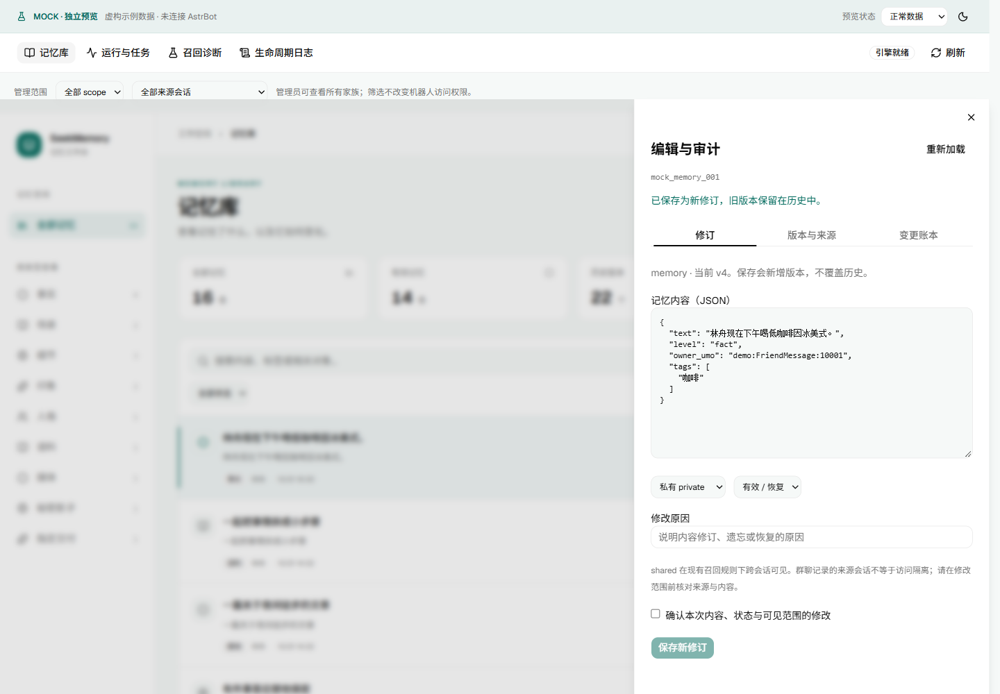
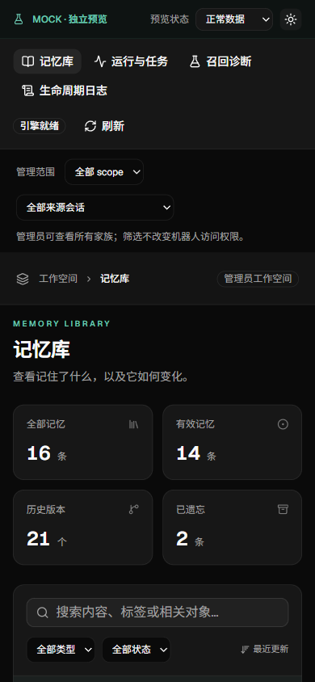

# SeekMemory 插件视图

安装 Release 的 `astrbot_plugin_seekmemory.zip`，重载插件，然后从 AstrBot 插件卡片的视图入口打开。
需要支持插件视图和 `astrbot.api.web` 的宿主；已验证 AstrBot 4.28.1 的请求上下文和生命周期 API。
旧入口“插件配置”继续编辑配置；新增“插件视图”用于记忆管理。没有修改 AstrBot 本体导航。
直接打开静态 HTML 或 `pnpm dev:host` 时若没有宿主桥接，会显示连接错误，不会显示示例记忆冒充真实数据。

## 记忆库

- 六种家族：memory（事实、场景、细节、印象）、persona、example、media、secret、designated。
- 支持关键词、类型、状态、scope、精确来源会话筛选；分页、版本对比、关联跳转、手机抽屉与深浅主题。
- 详情的“编辑与审计”提供原始 JSON、当前 header/lineage、历史 blob、原始来源证据和实际账本。
  来源或账本缺失时显示空集合，不补造历史。

| scope | 当前召回规则 |
|---|---|
| private | 仅归属会话；缺少归属时回退配置的 owner_umo，仍无归属则不进入候选 |
| shared | 跨会话进入候选，仍受召回相关性、交付与预算等规则影响 |
| shadow | 跨会话进入候选，组装时遮蔽正文，只输出影子句 |

管理员可以检查全部数据。“来源会话”是溯源和筛选维度，不代表 shared 被限制在来源群。
本次没有改变原有群聊识别或跨群共享政策；可用召回诊断核对具体 UMO 和说话人。

## 修订、遗忘与恢复

在编辑页修改 JSON、scope 或状态，填写原因并勾选确认后保存。
服务端使用既有 family 校验器检查内容，保留 ID/family/来源/其他头字段，产生 revision + 1。
旧版本、blob 和 Source 不被覆盖；账本记录修改原因以及前后内容哈希。
同内容但仅状态变化时，前后 blob 可以相同，头部快照仍记录新版本。

保存携带读取时的 revision。其他写入已改变该记录时返回冲突并保留草稿；重新加载后再核对保存。
遗忘可恢复为 active；merged 不能独立恢复，也不能用状态编辑伪造合并，避免破坏派生关系。
“载入该版本内容到修订草稿”只加载 payload，需返回修订页检查当前 scope/状态并显式保存为新版本。
人工编辑不自动重算既有 similar/temporal 图边；需要结合关联与诊断检查，后续整理沿用原有维护行为。

## 运行与任务

运行页显示引擎、账本哈希链、日志持久化、模型配置、定时任务数量和各会话待抽取消息。
模型检测只检查当前 provider 配置，不发送模型请求，也不保证网络/配额可用。
配置仍在 AstrBot 插件配置页修改；此处仅展示白名单配置字段。

- **立即抽取**：调用当前模型，复用会话分批、去重和写入流程。无待处理消息时直接完成。
- **每周整理**：执行既有衰减、相似合并和人格提炼；不额外调用模型。
- **取消**：请求取消当前任务。已完成的写入不会撤销；同步整理可能在取消请求处理前已经完成。

维护任务共用单任务执行器，运行期间人工编辑被拒绝。模型调用异常/取消时，未成功完成的会话
仍保留在 pending.json；超过会话上限的消息和调用期间新到的消息不会被清空。
抽取中已有的逐条容错仍保留：任务完成不保证每条模型输出都写入，需同时查看 warning 和 written 计数。
插件卸载/热重载会取消并等待任务、清理本实例路由、保存缓冲并关闭数据库。

## 召回诊断与日志

诊断输入查询消息、完整会话 UMO 和实际说话人 ID，复用真实 scope/召回/组装逻辑，显示预计注入文本、
决策计数及 scope 候选/排除 ID。不会调用模型，不改数据库，不消耗 designated 的一次性交付状态。
它只预演记忆模块，不模拟完整聊天链路；探索采样可能导致多次结果不同。

生命周期日志记录启动、停止、召回摘要、人工编辑、诊断及任务的 queued/running/succeeded/failed/
cancelled/interrupted 状态，可按类型、状态、任务 ID 和文本筛选。
内存/API 最多 500 条，`lifecycle.jsonl` 超过 1 MiB 轮转，保留一个备份；重启恢复范围限于保留的日志。
只记录计数、操作 ID 和错误类型，不记录对话/模型正文。来源证据在管理员详情页单独显示。
任务运行时每 2 秒刷新；空闲时手动刷新。这不是全量 AstrBot 控制台日志，也不是永久审计存档。

## 开发与截图

`cd dashboard && pnpm dev` 可独立运行全部页面，Mock 编辑只存在内存，任务不会调用模型。
Mock 诊断是简化的文本匹配，不能用于验证真实召回质量。源码、Mock、测试和截图不进入安装包。
完整工程说明见 [dashboard/README](../../dashboard/README.md)。

下图均为虚构 Mock 数据，布局与生产页共用组件。

